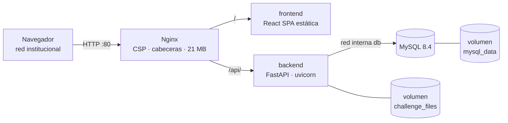

# CYBERLAB

**Portal educativo de ciberseguridad en español, con plataforma CTF propia, pensado para un curso de bachillerato de nueve meses.**

CYBERLAB reúne en un solo sistema autoalojado el currículo (cursos, módulos, lecciones y actividades), los retos CTF del profesor (con banderas que valida el servidor, cronómetro, pistas con coste y puntuación) y el seguimiento académico (XP, notas, analítica y reportes). Se despliega con Docker Compose en un servidor de la institución y, una vez construido, funciona sin conexión a Internet.

> **Estado:** en desarrollo activo. Las fases técnicas 0–10 y la fase 4 del SPEC v4 (currículo) están implementadas y verificadas. El cumplimiento completo del [SPEC v4](docs/SPEC.md) sigue abierto: la hoja de ruta está en [docs/REPAIR_PLAN.md](docs/REPAIR_PLAN.md) y el estado detallado en [PROGRESS.md](PROGRESS.md).

---

## Índice

- [Funcionalidades](#funcionalidades)
- [Arquitectura](#arquitectura)
- [Stack tecnológico](#stack-tecnológico)
- [Inicio rápido](#inicio-rápido)
- [Configuración](#configuración)
- [Comandos](#comandos)
- [Estructura del repositorio](#estructura-del-repositorio)
- [Desarrollo](#desarrollo)
- [Pruebas y calidad](#pruebas-y-calidad)
- [Seguridad](#seguridad)
- [Operación: copias, actualización y recuperación](#operación-copias-actualización-y-recuperación)
- [Documentación](#documentación)
- [Hoja de ruta](#hoja-de-ruta)
- [Contribuir](#contribuir)

---

## Funcionalidades

### Para estudiantes
- **Aprender:** el curso se organiza por meses. Incluye lecciones en Markdown, cuestionarios autocorregidos (se guarda el mejor intento), ejercicios, proyectos y retos CTF enlazados.
- **Retos CTF:** filtros por categoría, dificultad y estado; prerrequisitos con el motivo del bloqueo; evidencias que solo se descargan con sesión iniciada; pistas en orden con su coste visible antes de revelarlas; respuesta inmediata al enviar una bandera e intentos restantes.
- **Progreso:** XP, retos resueltos y en curso, tiempo de práctica, historial y centro de notificaciones.
- **Marcador:** global, por clase o por evento. Para estudiantes viene **desactivado por defecto**.

### Para docentes
- **Diseñar CTF:** eventos con ventanas de tiempo, clases asignadas y estrategia de puntuación. Retos con editor Markdown y vista previa, prerrequisitos, pistas, adjuntos y varias banderas por reto.
- **Estrategias de bandera:** `STATIC` (SHA-256, comparación en tiempo constante), `REGEX` (subconjunto seguro y acotado) y `DYNAMIC_HMAC` (bandera distinta para cada estudiante).
- **Puntuación:** `FIXED`, `TIME_DECAY` y `DYNAMIC_BY_SOLVES`, con multiplicadores por categoría y dificultad, penalización por pistas y escalas de notas configurables.
- **Currículo:** cursos propios o duplicados de la plantilla «Ciberseguridad — plan de 9 meses», un constructor de cuestionarios, una cola de revisión (aprobar, pedir cambios o rechazar) y una matriz de progreso por estudiante y módulo.
- **Paquetes de retos:** importación y exportación ZIP en un [formato portable versionado](docs/CHALLENGE_FORMAT.md). Antes de importar se muestra una vista previa con validación, y todo lo importado entra como borrador.
- **Analítica:** finalización, tiempos, fallos por reto, señales de inactividad, actividad de la clase en vivo, anuncios y exportación a CSV, XLSX o PDF.
- **Control en vivo:** pausar o reiniciar el progreso de un estudiante y congelar el marcador.

### Para administración
- Personas, periodos y clases, con importación CSV previsualizada.
- Roles y permisos (`recurso.acción`) editables. El rol `ADMIN` está protegido.
- Configuración (duración de sesión, intentos, límite de envíos, visibilidad del marcador).
- Bitácora de auditoría.

---

## Arquitectura



- **Un solo puerto publicado:** solo Nginx expone `80:80`. El frontend y la API no publican puertos.
- **Base de datos aislada:** MySQL vive en una red Docker `internal` a la que solo se une el backend.
- **Mismo origen:** la SPA y la API comparten origen, así que no hace falta una política CORS permisiva.
- **Migraciones automáticas:** el backend ejecuta `alembic upgrade head` al arrancar, antes de aceptar peticiones.
- **Mantenimiento interno:** cada seis horas una tarea elimina las sesiones expiradas o revocadas y los temporales antiguos.
- **Sin CDN:** las fuentes, los iconos y los scripts se empaquetan en la imagen. Internet solo hace falta para **construir** las imágenes.

Contrato técnico completo: [docs/CONTRACT.md](docs/CONTRACT.md) · Topología de red: [docs/NETWORK.md](docs/NETWORK.md).

---

## Stack tecnológico

| Capa | Tecnología |
|---|---|
| Backend | Python 3.12, FastAPI, SQLAlchemy 2, Alembic, Pydantic Settings, Argon2 (`argon2-cffi`), dependencias gestionadas con **uv** |
| Base de datos | MySQL 8.4 (compatible con 8.0+), InnoDB, `utf8mb4_0900_ai_ci`, `DATETIME(6)` en UTC |
| Frontend | Node 22 LTS, React, Vite, TypeScript, Tailwind (compilado localmente), React Router, TanStack Query/Table, Radix UI, React Hook Form + Zod |
| Cliente API | Tipos generados desde [docs/openapi.json](docs/openapi.json) con `openapi-typescript` y `openapi-fetch` |
| Proxy | Nginx (stable-alpine) |
| Orquestación | Docker Compose v2 |
| Calidad | pytest, Ruff, mypy (`strict`), Vitest, Testing Library, ESLint, Playwright |

---

## Inicio rápido

**Requisitos:** Docker Engine con Compose v2 (Docker Desktop sirve para desarrollo). Para despliegue estable se recomienda un servidor Linux.

```sh
# 1. Configuración: copia la plantilla y genera un secreto distinto para cada clave
cp .env.example .env
openssl rand -hex 32        # repítelo para cada secreto

# 2. Construir y arrancar (las migraciones se aplican solas)
make up                     # o: docker compose up --build -d

# 3. Datos iniciales, una vez (idempotente)
make seed                   # o: docker compose exec backend uv run python -m app.seed

# 4. Comprobar
curl http://localhost/api/v1/health
```

Abre `http://localhost` e inicia sesión con `ADMIN_USERNAME` / `ADMIN_PASSWORD` de tu `.env`.

El seed crea los roles, permisos, ajustes, categorías, dificultades, escalas de notas, la cuenta administradora, la plantilla curricular de 9 meses y el evento borrador `[DEMO]` con tres retos. **No crea cuentas de docente ni de estudiante:** créalas desde «Personas» o con una importación CSV.

> [!IMPORTANT]
> **El paso 3 es obligatorio.** Sin `make seed` la base queda vacía y el login responde `401 invalid credentials` aunque el `.env` sea correcto.
>
> `ADMIN_PASSWORD` solo se usa al **crear** la cuenta administradora. Si cambias esa variable después del primer seed, la contraseña guardada **no** cambia: cámbiala desde la aplicación.

---

## Configuración

Todas las variables se leen de `.env`. Ese archivo no se versiona; [.env.example](.env.example) es la plantilla.

| Variable | Obligatoria | Descripción |
|---|:---:|---|
| `MYSQL_ROOT_PASSWORD` | ✔ | Contraseña de `root` en MySQL. |
| `MYSQL_DATABASE` | | Nombre de la base (por defecto `cyberlab`). |
| `MYSQL_USER` | | Usuario de la aplicación (por defecto `cyberlab`). |
| `MYSQL_PASSWORD` | ✔ | Contraseña del usuario de la aplicación. |
| `BACKEND_SECRET_KEY` | ✔ | Secreto principal del backend. |
| `FLAG_HMAC_SECRET` | recomendada | Secreto de las banderas `DYNAMIC_HMAC`. Si falta, se usa `BACKEND_SECRET_KEY`. **Debe ser estable:** si cambia, todas las banderas dinámicas existentes dejan de valer. |
| `ADMIN_USERNAME` | | Usuario administrador inicial (por defecto `admin`). |
| `ADMIN_PASSWORD` | ✔ | Contraseña inicial del administrador (ver la nota del inicio rápido). |
| `APP_ENV` | | `development` o `production`. Usa `production` en despliegue. |
| `LOG_LEVEL` | | Nivel de log (por defecto `INFO`). |

Usa valores aleatorios largos y **distintos** para cada secreto, y limita los permisos del archivo (`chmod 600 .env`). Compose se niega a arrancar si falta alguna variable obligatoria.

---

## Comandos

| Comando | Qué hace |
|---|---|
| `make up` / `make down` | Construye y arranca / detiene los contenedores. Los datos se conservan. |
| `make migrate` | Aplica las migraciones a mano dentro del contenedor (el arranque ya lo hace). |
| `make seed` | Carga los datos base, de forma idempotente. Respeta los permisos de INSTRUCTOR y STUDENT ajustados en «Roles»; ADMIN siempre recibe todos. |
| `make reset-db CONFIRM=yes` | **Borra la base y los adjuntos**, reconstruye y vuelve a sembrar. Sin `CONFIRM=yes` no hace nada. |
| `make test` | pytest (backend) y Vitest (frontend). Requiere `uv` y Node 22 en el host. |
| `make lint` | Ruff, mypy, ESLint y build de producción. |
| `make e2e` | Recorridos reales en Chromium contra un stack en marcha. Requiere `CYBERLAB_E2E_USERNAME` y `CYBERLAB_E2E_PASSWORD` de una cuenta ADMIN y falla si faltan. Opcional: `CYBERLAB_E2E_BASE_URL`. |
| `bash scripts/backup.sh` | Copia de MySQL y de los adjuntos, con SHA-256 y rotación. |
| `bash scripts/restore.sh --confirm <dir>` | Restaura una copia. **Reemplaza** los datos actuales. |

<details>
<summary><strong>Windows sin GNU Make</strong> (equivalentes en PowerShell)</summary>

```powershell
docker compose up --build -d                                   # make up
docker compose down                                            # make down
docker compose exec -T backend uv run alembic upgrade head     # make migrate
docker compose exec -T backend uv run python -m app.seed       # make seed
cd backend; uv run pytest; cd ..\frontend; npm test; cd ..     # make test
cd backend; uv run ruff check .; uv run mypy app; cd ..\frontend; npm run lint; npm run build; cd ..   # make lint
```

Los scripts de copia funcionan en Git Bash.
</details>

---

## Estructura del repositorio

```text
.
├── backend/                  API FastAPI
│   ├── app/
│   │   ├── main.py           App, middleware y registro de routers
│   │   ├── *_api.py          Rutas HTTP (auth, users, classes, ctf, scoring, teaching…)
│   │   ├── *_service.py      Reglas de dominio
│   │   ├── models.py         Modelos SQLAlchemy
│   │   ├── security.py       Argon2id, sesiones, limitadores
│   │   ├── seed.py           Datos base idempotentes
│   │   └── modules/
│   │       └── curriculum/   Módulo con models · schemas · service · router · permissions
│   ├── migrations/versions/  Migraciones Alembic
│   └── tests/                pytest
├── frontend/                 SPA React + Vite
│   ├── src/
│   │   ├── api/              Cliente tipado (schema.d.ts generado)
│   │   ├── app/              Pantallas y rutas
│   │   ├── components/       UI reutilizable y página /design
│   │   └── features/         Features (curriculum/…)
│   └── e2e/                  Playwright
├── docker/nginx.conf         Proxy y cabeceras de seguridad
├── scripts/                  backup.sh · restore.sh
├── docs/                     Especificación, contrato, guías y OpenAPI
├── docker-compose.yml
├── Makefile
└── PROGRESS.md               Estado por fase
```

Los módulos nuevos se crean en `backend/app/modules/<nombre>/`, y los existentes se migran a esa forma cuando se tocan (decisión D4 en [docs/DECISIONS.md](docs/DECISIONS.md)).

---

## Desarrollo

Antes de cambiar nada, lee [docs/CONTRACT.md](docs/CONTRACT.md), [docs/DECISIONS.md](docs/DECISIONS.md) y [PROGRESS.md](PROGRESS.md). Guía de extensión: [docs/EXTENDING.md](docs/EXTENDING.md).

**Convenciones del API**
- JSON bajo `/api/v1`. La paginación usa `page`/`page_size` y devuelve `items`, `total`, `page` y `page_size`.
- Todos los errores (404, 405 y 500 incluidos) usan el mismo formato: `{"error": {"code": "STABLE_CODE", "message": "…", "details": {}}}`.
- Las mutaciones exigen la cookie de sesión y la cabecera `X-CSRF-Token`. Los permisos se comprueban en el servidor con `require_permission`.
- Las URL que ve el estudiante usan UUID públicos, nunca IDs internos.

**Flujo para un cambio de esquema o API**
1. Modelo en `models.py` (o en el módulo correspondiente) y **siempre** una migración Alembic reversible.
2. Lógica en el servicio de dominio y ruta delgada en el router. Valida las entradas y usa siempre consultas parametrizadas.
3. Actualiza [docs/openapi.json](docs/openapi.json) y regenera los tipos: `cd frontend && npm run api:generate`.
4. Pruebas en `backend/tests/` y/o en `frontend/src/**/*.test.tsx`.
5. `make test` y `make lint` en verde. Después actualiza `PROGRESS.md`.

**Frontend**
- Usa los tokens CSS `--campus-*` (tema claro y oscuro). No escribas colores hex en los componentes.
- Reutiliza [frontend/src/components/ui.tsx](frontend/src/components/ui.tsx) y cubre los estados de carga, vacío y error.
- Sistema visual: [docs/DESIGN_SYSTEM.md](docs/DESIGN_SYSTEM.md).

**Trabajo pendiente:** márcalo en el código como `TODO(fase-N)`.

---

## Pruebas y calidad

| Capa | Herramienta | Cobertura destacada |
|---|---|---|
| Backend | pytest | Banderas STATIC/REGEX/HMAC, límites de intentos, envíos concurrentes, empates y congelación del marcador, alcance docente y aislamiento entre docentes, zip-slip, enlaces simbólicos y ZIP bombs, neutralización de fórmulas en CSV, currículo |
| Backend | Ruff · mypy `strict` | Estilo y tipado estático |
| Frontend | Vitest · Testing Library | Componentes y pantallas de administración |
| Frontend | ESLint · `tsc -b` · `vite build` | Lint, tipos y build de producción |
| E2E | Playwright (Chromium) | Login, recorrido docente, recorrido estudiante y currículo, contra un stack real |

```sh
make test && make lint
CYBERLAB_E2E_USERNAME=admin CYBERLAB_E2E_PASSWORD='…' make e2e
```

---

## Seguridad

Resumen de los controles incluidos. El detalle está en [docs/SECURITY.md](docs/SECURITY.md).

- **Autenticación:** contraseñas con Argon2id. Las sesiones son opacas, se guardan en el servidor (en la base solo queda el SHA-256 del token) y viajan en cookies `HttpOnly`, `SameSite=Lax` y `Secure` cuando la petición llega por HTTPS. Cada sesión tiene su token CSRF.
- **Contraseñas temporales:** mientras no se cambien, la API solo responde a `/auth/*` y el resto devuelve `403 PASSWORD_CHANGE_REQUIRED`. Cambiar la contraseña revoca las demás sesiones de la cuenta.
- **Autorización:** RBAC con permisos `recurso.acción` y **alcance docente** verificado en el servidor (un docente solo ve y modifica eventos, clases e importaciones de sus propias clases). No se puede desactivar ni la propia cuenta ni al último administrador activo.
- **Limitación de intentos:** el login cuenta solo los fallos, con 8 por equipo+usuario y 120 por equipo cada 5 minutos. Los envíos de bandera se limitan por estudiante y con una ráfaga mínima por IP. Nginx **reemplaza** `X-Forwarded-For` para que nadie elija su propia identidad de limitación.
- **Banderas:** se validan solo en el servidor. Las estáticas se guardan como hash y los intentos guardan el hash del texto enviado. Las respuestas al estudiante nunca incluyen banderas, configuración ni pistas sin desbloquear.
- **Datos no confiables:** los ZIP de retos se leen en memoria con límites de tamaño, número de entradas y rutas, y el YAML se carga en modo seguro sin alias. Nada de lo incluido se ejecuta. Los adjuntos se guardan con nombres aleatorios y su tipo se detecta por la firma del archivo.
- **Cabeceras:** CSP restrictiva autoalojada, `X-Content-Type-Options`, `X-Frame-Options: DENY`, `Referrer-Policy`, `Permissions-Policy` y `server_tokens off`.

**Antes de abrir la plataforma a estudiantes:** pon `APP_ENV=production`, usa secretos únicos, termina TLS en un gateway institucional de confianza delante de Nginx (el Compose base sirve solo HTTP), expón el servicio solo en una VLAN controlada y restringe el acceso al daemon Docker.

**Límites conocidos:** los contadores de los limitadores viven en memoria de cada proceso, así que no se comparten entre réplicas y se reinician con el backend. El contenedor del backend todavía se ejecuta como root (deuda documentada en DECISIONS).

¿Has encontrado una vulnerabilidad? Comunícala de forma privada a quien mantiene el proyecto. **No abras una incidencia pública.**

---

## Operación: copias, actualización y recuperación

- **Copias:** `scripts/backup.sh` genera un volcado transaccional de MySQL y un tar del volumen de adjuntos, con sumas SHA-256 y 14 días de retención. El destino se configura con `CYBERLAB_BACKUP_DIR` y la retención con `CYBERLAB_BACKUP_RETENTION_DAYS`. En [docs/BACKUP.md](docs/BACKUP.md) hay ejemplos para cron y systemd.
- **Restauración:** `scripts/restore.sh --confirm <copia>` verifica las sumas y las rutas, detiene el backend, restaura y lo vuelve a arrancar.
- **Actualización:** haz una copia, ejecuta `docker compose up --build -d` (las migraciones se aplican al reiniciar) y revisa en «Roles» los permisos nuevos de INSTRUCTOR y STUDENT.
- **Fuera de la copia:** `.env`, las imágenes Docker, los logs del host y los certificados del gateway. Resguárdalos por separado.
- **Laboratorio sin Internet:** construye las imágenes en una máquina con acceso y trasládalas con `docker save` / `docker load`.

> [!CAUTION]
> `docker compose down -v` y `make reset-db` **eliminan la base de datos y los adjuntos**. No los uses en una instalación con datos reales.

---

## Documentación

| Para | Documento |
|---|---|
| Visión y requisitos | [docs/SPEC.md](docs/SPEC.md) |
| Contrato técnico | [docs/CONTRACT.md](docs/CONTRACT.md) |
| Decisiones de arquitectura | [docs/DECISIONS.md](docs/DECISIONS.md) |
| Estado por fase | [PROGRESS.md](PROGRESS.md) |
| Instalación y actualización | [docs/INSTALLATION.md](docs/INSTALLATION.md) |
| Red y servicios | [docs/NETWORK.md](docs/NETWORK.md) |
| Seguridad | [docs/SECURITY.md](docs/SECURITY.md) |
| Copias y restauración | [docs/BACKUP.md](docs/BACKUP.md) |
| Solución de problemas | [docs/TROUBLESHOOTING.md](docs/TROUBLESHOOTING.md) |
| Motor de banderas y puntuación | [docs/SCORING.md](docs/SCORING.md) |
| Formato de paquetes de retos | [docs/CHALLENGE_FORMAT.md](docs/CHALLENGE_FORMAT.md) |
| Extender la plataforma | [docs/EXTENDING.md](docs/EXTENDING.md) |
| Sistema visual | [docs/DESIGN_SYSTEM.md](docs/DESIGN_SYSTEM.md) |
| Guía de administración | [docs/ADMIN_GUIDE.md](docs/ADMIN_GUIDE.md) |
| Guía docente | [docs/TEACHER_GUIDE.md](docs/TEACHER_GUIDE.md) |
| Guía del estudiante | [docs/STUDENT_GUIDE.md](docs/STUDENT_GUIDE.md) |
| Especificación OpenAPI | [docs/openapi.json](docs/openapi.json) |
| Auditoría y reparación | [docs/FULL_AUDIT.md](docs/FULL_AUDIT.md) · [docs/REPAIR_PLAN.md](docs/REPAIR_PLAN.md) · [docs/FINAL_VERIFICATION.md](docs/FINAL_VERIFICATION.md) |

---

## Hoja de ruta

Pendiente según [PROGRESS.md](PROGRESS.md) y [docs/REPAIR_PLAN.md](docs/REPAIR_PLAN.md):

- **Fase 6 del SPEC:** la fórmula de puntuación §7.1 (base, tiempo, reflexión, pistas y piso) como estrategia por defecto, y el descuento del coste de las pistas del currículo.
- **Fase 11 del SPEC:** plataformas externas, entregas con evidencias y archivos en proyectos, y el tipo de actividad `external_challenge`.
- **Fase 12 del SPEC:** revisión visual global con la identidad «cuaderno universitario» (D1).
- **Deuda técnica:** contenedor backend sin privilegios (necesita migrar la propiedad del volumen), cliente generado para subidas binarias, asignación de roles personalizados y colores heredados sin token.
- **Futuro:** laboratorios Docker aislados (`lab-manager`), integración con un LMS y almacenamiento compartido de los limitadores junto con métricas y alertas para varias réplicas.

---

## Contribuir

1. Lee [CLAUDE.md](CLAUDE.md), [docs/CONTRACT.md](docs/CONTRACT.md), [docs/DECISIONS.md](docs/DECISIONS.md) y [PROGRESS.md](PROGRESS.md).
2. Implementa **una fase cada vez**. Mantén la lógica de negocio en los servicios de dominio.
3. No añadas dependencias desde CDN ni subas secretos al repositorio.
4. Si una decisión choca con el contrato o el SPEC, regístrala en `DECISIONS.md` en vez de cambiarla en silencio.
5. Antes de abrir un PR: `make test`, `make lint` y, si cambias flujos de usuario, `make e2e`.

---

<sub>Este repositorio aún no incluye un archivo de licencia. Hasta que se añada uno, consulta con quien mantiene el proyecto antes de reutilizar el código.</sub>
